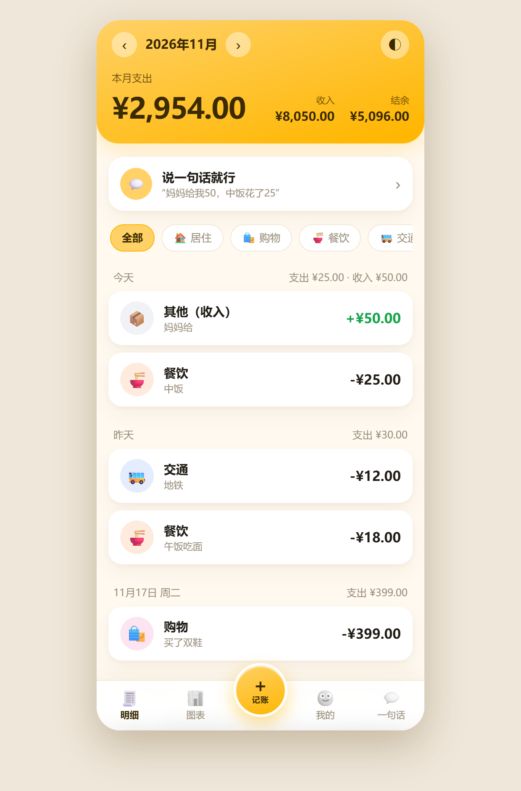
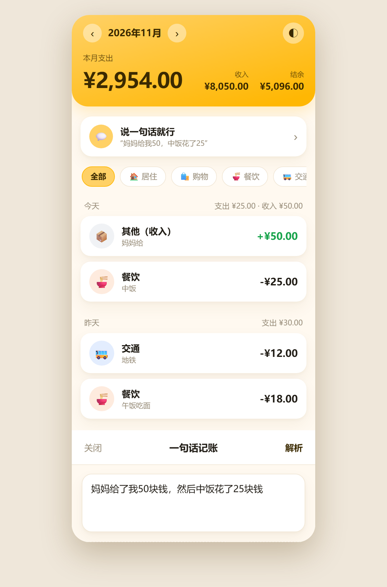

# 口袋账本 · Pocket Ledger

一个**完全离线**的安卓记账 App：不用注册、不联网、数据只存在手机里。
最大的特点是「**一句话记账**」——说一句「妈妈给了我50块钱，然后中饭花了25块钱」，
它会自动拆成 **+¥50 收入** 和 **−¥25 餐饮支出** 两笔，并告诉你本次结余。

<p align="center">
  
  
</p>

## 功能

- **一句话记账**：一段大白话，自动拆成多笔收支
  - 收入/支出判断：「给了我」「收到」「发工资」「花了」「付了」「买了」
  - 分类识别：餐饮、交通、购物、居住、娱乐、医疗、学习、通讯、人情…
  - 中文数字：`一百二十块`、`五十` 都能认
  - 日期：`昨天`、`前天`、`上周五`、`11月3日`、`15号`，没写日期就记为当天
  - 解析结果可逐条改类型、删掉，确认后再写入
- **手动记账**：大号数字键盘，选分类 → 输金额 → 保存，三步完成
- **月度汇总**：本月支出 / 收入 / 结余，按天分组，带当日小计
- **统计图表**：分类占比排行、近 6 个月支出柱状图、日均支出
- **数据自主**：导出 CSV（Excel 可直接打开）、导出/导入 JSON 备份、一键清空
- **深色模式**：跟随系统或手动切换
- **离线 PWA**：同一份代码在浏览器里也能用，可「添加到主屏幕」

## 安装（安卓手机）

1. 到 [Releases](../../releases) 下载 `app-release.apk`
2. 手机上点开 APK，按提示允许「安装未知来源应用」（华为/鸿蒙在
   `设置 → 安全 → 更多安全设置 → 外部来源应用下载` 里允许浏览器安装）
3. 装完桌面上会出现「口袋账本」图标

> 华为 P40 等无 Google 服务（HMS）的机型同样可用：App 不依赖任何 Google 组件，也不申请网络权限。

## 一句话记账怎么用

打开 App 底部的「**一句话**」，输入（或点输入法键盘上的 🎤 直接说）：

```
妈妈给了我50块钱，然后中饭花了25块钱
```

点「解析」得到：

| 类型 | 分类 | 金额 | 日期 |
| --- | --- | --- | --- |
| 收入 | 其他 | +¥50.00 | 今天 |
| 支出 | 餐饮 | −¥25.00 | 今天 |

底部显示 `共 2 笔 · 收入 +¥50.00 支出 -¥25.00`、`本次结余 +¥25.00`，
确认无误点「全部记入」即可。

支持的写法举例：

- 多笔用逗号 / 顿号 / 「然后 / 还有 / 另外」分隔：`早饭12、地铁8、奶茶22`
- 指定日期：`昨天打车35`、`11月3日看电影花了60`
- 收入：`发工资8000`、`收到红包200`、`淘宝退给我199`
- 中文数字：`水电费一百二十块`

解析不确定时宁可不记，也不会乱记；记错了在列表里点那一条随时改。

## 自己构建

需要 JDK 17 与 Android SDK（platform 34、build-tools 34.0.0）：

```bash
# 调试包
./gradlew assembleDebug
# 发布包（使用 debug 签名，方便侧载安装）
./gradlew assembleRelease
```

产物在 `app/build/outputs/apk/`。

不想装环境也可以：推到 GitHub 后由 Actions 自动构建，
打 `v*` 标签时会自动把 APK 附到 Release 上（见 `.github/workflows/android.yml`）。

## 技术实现

| 部分 | 做法 | 为什么 |
| --- | --- | --- |
| UI | 内置 WebView + 原生 HTML/CSS/JS（`app/src/main/assets/app`） | 一套代码同时是 APK 和网页版，改样式快，界面统一 |
| 存储 | WebView `localStorage` | 零依赖、零权限，数据不出手机 |
| 记账解析 | `nlp.js` 规则引擎（正则 + 关键词 + 中文数字） | 完全离线，不需要把账目发到任何服务器 |
| 导出 | 原生 `MediaStore` 写入 `Download/口袋账本/` | Android 10+ 免存储权限 |
| 原生壳 | `MainActivity.java` 约 250 行 | 只做网页做不了的事：写文件、选文件、返回键、系统对话框 |

没有第三方运行时依赖，APK 只有几百 KB。

```
app/src/main/assets/app/
├── index.html     界面结构
├── app.css        样式（暖黄配色、深色模式）
├── app.js         记账、统计、导入导出
├── nlp.js         一句话记账解析器（可独立单测）
├── sw.js          PWA 离线缓存
└── icons/         PWA 图标
```

## 解析器测试

`nlp.js` 不依赖 DOM，用无头 Edge 跑用例集：

```powershell
powershell -ExecutionPolicy Bypass -File tools\run-nlp-test.ps1
```

覆盖 13 个用例：多笔拆分、收支判断、分类、日期继承、中文数字、量词排除等。

## 隐私

- 没有 `INTERNET` 权限，物理上无法联网上传数据
- 只有 Android 9 及以下才申请存储权限（用于导出文件）
- 卸载 App 或「清空全部记录」后数据即消失，重要账目请定期导出备份

## 许可

[MIT](LICENSE)
